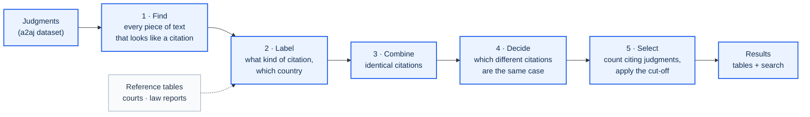
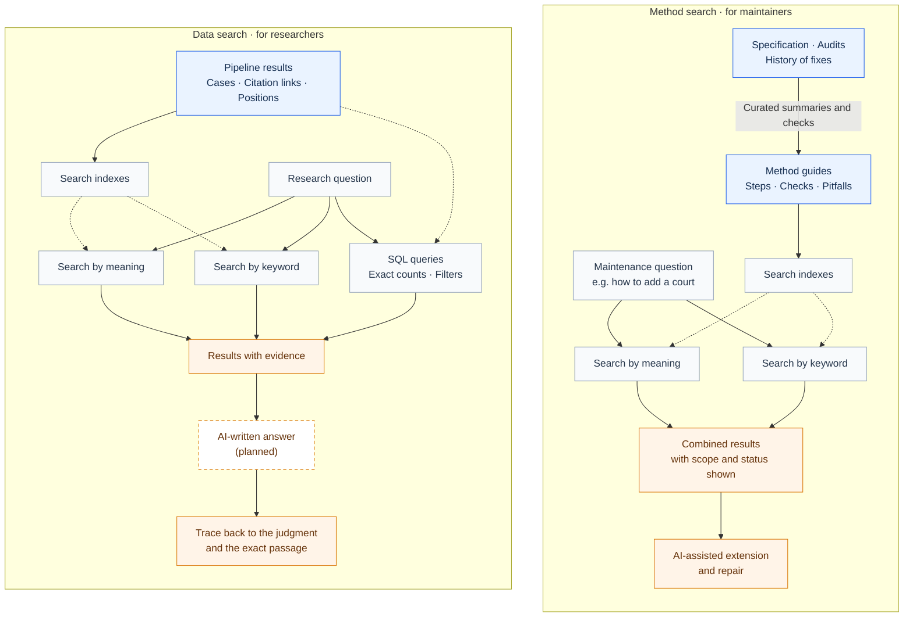

# Case Citation Pipeline

[](https://doi.org/10.5281/zenodo.23149206)

[](LICENSE)
[](https://huggingface.co/datasets/a2aj/canadian-case-law)

Courts constantly cite earlier cases. This project reads the available judgments of a court, finds the cases they cite, works out which differently written references belong to the same case, and counts how many different judgments cite each one. The aim is to make citation research reproducible: each counted link leads back to a source judgment and a passage in its text.

It has been run on three Canadian courts — the Supreme Court of Canada (SCC), the Court of Appeal for Ontario (ONCA), and the Court of Appeal for British Columbia (BCCA) — using the public [a2aj Canadian case law dataset](https://huggingface.co/datasets/a2aj/canadian-case-law). Historical results have been compared with [CanLII](https://www.canlii.org). Adding another court means checking its citation styles and source coverage as well as changing a setting.

**Research status (2026-10-16):** the five-step pipeline, source tracing, exact counts and offline research queries are implemented for a defined three-court corpus. The current research goal is a reproducible dataset for a paper on Canadian judicial citation patterns. Paper-specific quality assessment and a fixed, citable export remain to be completed.

The main dataset tables and foreign-citation example describe **`run_20261016_country_complete`**. Repair comparisons and historical quality studies name their own runs. The source code now includes later repairs, committed in `d23e074`; those repairs have not replaced the active dataset. The [retained repair comparison](#recent-repairs-and-their-evidence) describes an intermediate completed run. The subsequent full rerun was cancelled and its outputs deleted, so it supplies no new dataset results.

| | |
| --- | --- |
| **The problem** | The same case is written in many different ways: the court's own citation (`2002 SCC 33`), law-report references (`[2002] 2 S.C.R. 235`), database IDs, and old footnote styles. Finding an abbreviation is only the beginning; these references need to be linked before counting. |
| **The approach** | Five steps: find anything shaped like a citation, label it, combine duplicates, decide which citations are the same case, and count. Rejected readings and groups below the cut-off remain available for inspection, and reference rules record their evidence. |
| **What you get** | Citation and case-group tables, counts, and source passages that support research into which cases courts cite and how citation patterns change. Search tools help researchers explore the results and maintainers understand the method. |
| **Quality evidence** | Historical source-text reviews and retained repair comparisons document known strengths and failures. Their run IDs, samples and unresolved judgments are explained [below](#how-well-it-works). A current-run, paper-specific accuracy estimate remains open. |

A citation means a judgment **mentions** a case. It does not by itself show approval, following, or reliance. Read [the counting and usage guide](docs/USAGE.md) before quoting any number; this is research data, not legal advice.

## What the final data looks like

The pipeline's output is a list of case groups, each with one key number: **DD**, or **distinct decisions**. DD counts the different source judgments that cite a group. If one judgment mentions the same case twenty times, it adds one to DD and twenty to the mention count.

All groups stay in the tables. The select step defaults to **DD ≥ 1**:

| DD | Meaning | In the current snapshot |
| --- | --- | ---: |
| **1 or more** | Kept in the main view; cited by at least one judgment. | 228,102 groups |
| **Below 1** | No final counted link after exclusions; still available for inspection. | 2,347 groups |
| **All groups** | Includes groups without a final counted link after exclusions. | 230,449 groups |

A high DD means more different judgments cite the group. It does not prove that all the references were assigned to the right case, or that the citing courts relied on it. A low DD may describe a rarely cited case or an extraction or identity mistake. The optional DD ≥ 5 filter has not been formally calibrated. The historical audit found fewer non-case citations in higher-DD groups, but it did not establish identity accuracy.

## Example: one paragraph through two steps

`scripts/demo.py` runs the first two steps (find and label) on a made-up paragraph. It needs no downloaded data and no internet:

```text
[12] The standard of review was settled in Housen v. Nikolaisen, 2002 SCC 33, [2002] 2 S.C.R. 235.
The English rule in Donoghue v. Stevenson, [1932] A.C. 562 (H.L.), was applied. See also R. v. Oakes,
[1986] 1 S.C.R. 103, and section 7 of the Act, R.S.C. 1985, c. C-46.
```

```console
$ python scripts/demo.py
raw_string            shape                 offset   kind       jurisdiction  parse_status         court
2002 SCC 33           neutral_bare          65       neutral    CA            valid                -
2002 SCC 33           vol_abbr_page         65       reporter   UNSUPPORTED   ambiguous_year_vol   -
[2002] 2 S.C.R. 235   bracket               78       reporter   CA            valid                -
2 S.C.R. 235          vol_abbr_page         85       reporter   CA            valid                -
[1932] A.C. 562       bracket               142      reporter   GB            valid                H.L.
[1986] 1 S.C.R. 103   bracket               201      reporter   CA            valid                -
1 S.C.R. 103          vol_abbr_page         208      reporter   CA            valid                -
```

How to read this:

- `shape` is the text pattern that matched; `offset` is the character position where the citation starts.
- `kind`: `neutral` is the court's own case number (like `2002 SCC 33`); `reporter` is a reference to a printed law report (volume, report name, page, like `[2002] 2 S.C.R. 235`).
- `jurisdiction` is the citation classification (`CA` Canada, `GB` United Kingdom). For a reporter citation, this can describe the law report rather than the case's origin; origin is established separately. `UNSUPPORTED` means the classification is unknown.
- `parse_status` says whether the citation reads cleanly (`valid`) or is doubtful.
- The find step keeps every possible reading of the text, so `2002 SCC 33` appears twice: once correctly, as a neutral citation, and once misread as volume 2002 of a law report called `SCC`, which the label step marks as doubtful (`ambiguous_year_vol`). The combine step chooses between overlapping readings later.
- `[2002] 2 S.C.R. 235` and `2 S.C.R. 235` are the same reference matched twice (with and without the year); it is counted once later.
- `(H.L.)` (House of Lords) is recorded as the court that decided the English case.
- The statute reference at the end is correctly *not* picked up as a case citation.

### What the full pipeline makes possible

The two steps above find and label pieces of text. The later steps decide which references belong to the same case and count how many different judgments cite it. This makes a concrete research question possible: **which foreign judgments appear in Canadian courts' reasons, and how does that pattern vary by court and decade?** The source passages then let a researcher investigate what those citations were doing.

The table shows the five most-cited of **27,723 groups with assessed foreign references** in the 2026-10-16 snapshot. DD is counted across SCC, ONCA, and BCCA:

| Cited by (different judgments) | Case | Citation | Origin |
| ---: | --- | --- | --- |
| 173 | Anns v. Merton London Borough Council | [1978] A.C. 728 | GB (United Kingdom) |
| 108 | Donoghue v. Stevenson | [1932] A.C. 562 | GB (United Kingdom) |
| 58 | Quinn v. Leathem | [1901] A.C. 495 | GB (United Kingdom) |
| 52 | Salomon v. Salomon & Co | [1897] A.C. 22 | GB (United Kingdom) |
| 48 | Hedley Byrne & Co. v. Heller & Partners Ltd | [1964] A.C. 465 | GB (United Kingdom) |

The [saved ranking and coverage evidence](audit/findings/country_assessment_20261016/foreign_top5.json) records the run and query. With the documented run active locally, reproduce it with:

```powershell
python tools/research/research.py ask --intent ranking --origin FOREIGN --top 5 --evidence-limit 0 --language en --output audit/findings/research/foreign_top5.json
```

Origin is distinct from the country of the law report. Makin and Ibrahim were decided in London by the Privy Council, which heard appeals from across the British Empire, but the appeals originated in Australia and Hong Kong. An English report alone therefore cannot establish a British origin. The pipeline assigns origin only when citation evidence or a verified reference rule supports it.

Coverage is still incomplete. Origin is known for **199,207 of 228,102 groups with counted links (87.3%)**, and for **457,884 of 490,577 citation links (93.3%)**; **32,693 links** have undetermined origin. The identified foreign subset contains **27,723 groups and 42,590 links**. These rates measure available origin assessments. Citation detection and correct judgment identity require their own quality measures. The [coverage report](audit/findings/country_assessment_20261016/coverage.json) gives the counts and definitions; groups without a final counted link are outside this comparison.

These are results for the identified subset, not a complete ranking of foreign influence. Unknown origins are not treated as foreign and are not extrapolated. Court-and-decade comparisons must carry their own coverage denominators: a change in known foreign citations may reflect coverage as well as changes in judicial citation practice.

## Pipeline



1. **Find** anything shaped like a citation (year, court code, volume, page). No abbreviation list is needed, so unfamiliar reports are still caught.
2. **Label** each one: what kind of citation, which country, and whether it is only a look-alike or a judgment citing itself.
3. **Combine** identical citations and resolve text that could be read two ways.
4. **Decide** which different citations are the same case — for example a case number and a law-report reference printed side by side — and keep apart different cases with the same name.
5. **Select** by DD (the number of different judgments citing each case). The default view keeps DD of 1 or more; optional profiles apply higher cut-offs. Every group remains available in the output tables.

The steps keep their own outputs and decision evidence, so an unexpected count can be traced back through the grouping and parsing decisions to the text. The [reference tables](decisions/) record the evidence used by the rules. When origin cannot be established, it remains unknown. Earlier and later judgments in the same litigation must be distinguished from multiple references to one judgment.

### Data

The judgments come from the [`a2aj/canadian-case-law`](https://huggingface.co/datasets/a2aj/canadian-case-law) dataset on Hugging Face. This project does not collect them itself. The documented production snapshot is **run_20261016_country_complete**, completed on **2026-10-16**, using English text when available and French text otherwise.

| Court | Source records | English text selected | French fallback | No usable text | Observed years |
| --- | ---: | ---: | ---: | ---: | --- |
| Supreme Court of Canada (SCC) | 10,891 | 10,829 | 62 | 0 | 1877–2026 |
| Court of Appeal for Ontario (ONCA) | 24,089 | 23,953 | 136 | 0 | 1998–2026 |
| Court of Appeal for British Columbia (BCCA) | 14,703 | 14,694 | 0 | 9 | 1999–2026 |
| **Total** | **49,683** | **49,476** | **198** | **9** | |

The text policy selects one field per source record: English when available, otherwise French. **49,674 records contain usable text.** The language columns describe selected source fields, rather than independently detected language. The retained extraction manifest records these counts. Observed year ranges do not establish complete coverage of every judgment in those years.

The three-court snapshot excludes trial courts, other appeal courts, federal courts and tribunals. Separate court experiments do not expand this scope. A cited group can refer to a judgment whose full text is outside the source corpus. Court-and-year comparisons should report both the available source records and the usable-text denominator. Select pipeline courts with repeated `--court` arguments; `PIPELINE_COURTS` remains supported. New courts require review of their source coverage and citation styles.

The first number below is much larger than the others because it includes repeated mentions and duplicate readings of the same text:

| Measure | Count |
| --- | ---: |
| Possible citation matches | 1,472,144 |
| Citation members used in case grouping | 261,029 |
| Case groups | 230,449 |
| Links from a source judgment to a cited group | 490,577 |
| Counted mentions in those links | 705,476 |
| Groups cited by at least five different judgments | 14,003 |

The retained [release summary](audit/findings/project_review_20261015/release_summary_final.json) records these counts; the [current snapshot comparison](audit/findings/country_assessment_20261016/impact.json) confirms that grouping, DD, links and counted mentions are unchanged. The [mention reconciliation](audit/findings/project_review_20261015/edge_counters.json) explains why an earlier step log has 716,593 mentions: it includes 11,117 later excluded as self-citations. Source records, groups, links, and mentions are different units.

Save the run ID with every research result: group IDs and counts can change between runs. On a configured local installation, `data/active_run.json` selects the active run and database, and `python tools/status.py` reports availability. Large corpus files and generated databases are local inputs and outputs; a source checkout alone does not contain the full results.

### Recent repairs and their evidence

The [saved repair comparison](audit/findings/fix_batch_20261016/validation.json) compares the documented dataset, `run_20261016_country_complete`, with the historical repair run, `run_20261016_fixes_full3`. That repair run's generated outputs are now retired; the saved comparison and source evidence remain:

| Diagnostic | Documented dataset | Retired repair run |
| --- | ---: | ---: |
| Citation keys appearing in multiple groups | 11,644 | 65 |
| Groups containing two different printed deciding courts | 42 | 0 |
| Adjacent appeal-history pairs still in one group, among 9,647 fixed probes | 1,703 | 38 |
| Unnamed display groups that have a named member | 522 | 0 |
| Display names beginning with the measured prose lead-ins | 4,203 | 54 |

These are anomaly counts and fixed diagnostic probes. They demonstrate changes in known failure patterns; they do not estimate population precision or recall. The repair run also changes group counts and coverage denominators, so its figures must remain attached to its own run ID.

Later source changes add source-bound separation evidence, conservative reporter court constraints, corrected French/name boundaries and complete nonstandard report locators. They retain the evidence for decisions and preserve ambiguous cases for review. Their full-corpus effect has not been measured in a completed follow-up run. The [problem ledger](PROBLEMS.md) and [source evidence](audit/findings/followup_fixes_20261016/) record the scope of these changes.

## Two search systems on top of the pipeline

The pipeline produces both research results and a record of how each step was built, checked, and fixed. Search is a way to use this work: researchers explore cases and passages, while maintainers find rules, code, and earlier problems before extending the method.



The diagram includes planned features. **Keyword data search and exact table queries are available for the documented run. Vector search is unavailable for that run, and AI-written research answers remain planned.** Method search reflects its indexed source snapshot; later code or documentation edits require an explicit index refresh to appear in search. Method guides and audit records include model-assisted work and are not all independently human-reviewed.

### Data search

After a run, the tables can be loaded into a local database. Case profiles bring together names, citations, DD, and sample passages. A researcher can search a case name, inspect the judgments citing it, and return to the source text. Exact counts come from the full tables, not the first few search hits.

```powershell
python tools/status.py
python tools/foundation/query.py "Donoghue" --run run_20261016_country_complete --mode keyword -k 5
python pipeline/trace_source.py --run-dir data/run_20261016_country_complete --search "Donoghue v. Stevenson"
python tools/research/research.py find "Housen" --top 5 --language en --output audit/findings/research/housen.json
python tools/research/research.py ask --intent court_decade --language en --output audit/findings/research/trend.json
python tools/research/research.py ask --intent ranking --top 10 --with-text --language en --output audit/findings/research/top10.json
```

The [research tool](tools/research/README.md) saves query parameters, exact counts, coverage context, and a limited set of source passages. Its `ask` command supports defined question types; it does not generate an answer to an arbitrary legal question. The [retained court-and-decade result](audit/findings/research_20261015/active_court_decade.json) is an example of a reproducible research output.

Optional weighted DD uses experimental citation-quality weights. It does not measure importance, treatment, or identity correctness, and historical weights should not be presented as current-run accuracy. Production DD remains the unweighted count of distinct citing judgments.

### Method search

The code, reference tables, specification, audit reports, and method guides are split into searchable pieces linked to their source files. A maintainer exploring how to add a court can find the guide, the relevant code, and earlier failures. Method search is project-wide; data search should specify the intended run.

```powershell
python tools/foundation/query.py "new court" --collection methods --mode keyword
```

Both indexes can be rebuilt with [`after_run.py`](tools/foundation/after_run.py). The default build is offline and skips vectors; optional embeddings require separate configuration. See the [search setup guide](tools/foundation/README.md).

The [quality tool](tools/quality/README.md) supports sampling and review. Experimental short-citation and treatment tooling is retained locally and excluded from version control. It does not change production DD or establish judicial reliance.

## How well it works

### Source-text model review of the October 15 run

On 2026-10-15, a model assessed all **270 links** in a fixed sample from `run_20261015_identity_review`. It read source evidence and checked both whether a case was mentioned and whether the link pointed to the right judgment.

| Question | Model decisions | Weighted score among decided records | Share of sample weight decided |
| --- | --- | ---: | ---: |
| Does the source mention a case? | 265 yes, 3 no, 2 unknown | 93.9% | 95.3% |
| Is it a case mention linked to the right judgment? | 118 correct, 18 incorrect, 134 unknown | 90.9% | 77.1% |

Weights account for different chances of selection. Unknowns count as neither correct nor incorrect, so the scores describe only the records the model could decide. In particular, **90.9% is not an accuracy estimate for the whole pipeline**. All 270 records received model assessments; none received manual labels in this review. The recorded model was `gpt-6.1-sol`, with 77 assessments at Max and 193 at Medium reasoning effort. See the [review results, raw rates, and reproducible commands](audit/findings/quality_model_review_20261015/README.md).

### Historical CanLII comparison

These are **historical results for run_20261002_tables2**, the run dated **2026-10-02**. The October 15 model review uses a different method and evidence; the two sets of scores are not directly comparable.

The [T6 audit](audit/findings/canlii_crosscheck/run_20261002_tables2/t6_calibration.md) checked **215 links** by reading source text. The links were sampled within a comparison set of **360 judgments** across three courts and three time periods per court. Results were weighted by the number of links in each sampling category; they are not simple percentages of the sample.

| DD of the cited group | Links checked | Weighted share that were real case citations |
| --- | ---: | ---: |
| 1 | 76 | 75.0% |
| 2–4 | 53 | 81.7% |
| 5–9 | 29 | 98.9% |
| 10 or more | 57 | 100% |
| Overall | 215 | 87.0% |

The overall approximate interval was **75.0%–92.3%**. The remaining weighted shares were 8.2% errors and 4.8% mentions of earlier stages or reports of the same case. The audit counted a real case citation as correct even if its group had the wrong name. It therefore does not establish case-identity accuracy or tell us how a court treated a case. Small samples also limit what the 100% result can tell us about other links.

**How much of CanLII's citation list is matched?** The separate [T2 comparison](audit/findings/canlii_crosscheck/run_20261002_tables2/t2_summary.md) used 40 judgments in each court-and-period sample. For SCC, it matched 97.3% of CanLII-listed citations in 2000–2026, 79.8% in 1950–1999, and 36.4% in 1875–1949. ONCA and BCCA samples ranged from 70.2% to 96.9%. These are coverage figures against CanLII, not a complete measure of missed text citations: different source texts, grouping, exclusions, and CanLII records can all affect the comparison. For example, the oldest SCC sample's 68 CanLII-only cases included five extracted but grouped elsewhere; the automated name check could not locate the other 63 in the source text. That finding does not establish that the source contains no missed citations.

**Do the “cited by” lists agree?** The historical [T3 comparison](audit/findings/canlii_crosscheck/run_20261002_tables2/t3_summary.md) examined 60 sampled cited groups plus Housen. Within comparable citing judgments from the same three courts and corpus, 98.5–99.8% of the pipeline's citing judgments also appeared in CanLII's lists across the three sampled periods. The pipeline found 82.7% of CanLII's citing judgments for pre-1950 cases, 89.2% for 1950–1999 cases, and 99.5% for 2000–2026 cases. Citing judgments that could not be mapped to a CanLII ID were excluded, so those percentages apply to the comparable subset.

The original outputs for `run_20261002_tables2`, `run_20261003_selfcite`, and `run_20261003_v16f` have been retired. Small receipts, manifests, logs, and audit reports remain: [retirement receipt and retained record paths](audit/findings/repository_cleanup_20261015/retired_runs.json). These records describe past runs; they cannot replace the original full outputs.

Automated checks cover extraction, grouping, run integrity, and the research tools; the [verification record](audit/findings/repository_cleanup_20261015/validation.json) records the results. These checks catch software and table errors; source-text reviews address whether a citation was understood correctly. Open problems and remaining work are tracked in [PROBLEMS.md](PROBLEMS.md) and [DEBT_LEDGER.md](DEBT_LEDGER.md).

## Repository layout

| Location | Purpose |
| --- | --- |
| `pipeline/` | The five processing steps and their focused regressions |
| `decisions/` | Sourced citation, court and identity policies |
| `tools/research/`, `tools/foundation/` | Research exports, local database and search |
| `audit/`, `docs/` | Small evidence records, method documentation and research limitations |
| `PROBLEMS.md`, `DEBT_LEDGER.md` | Recorded defects, dispositions and remaining work |
| `corpus/`, `data/` | Local source corpora and generated outputs, excluded from Git |
| `implementation/` | Working notes and temporary analysis; mostly excluded from Git |

Keep source changes and necessary small evidence records in Git. Manage large generated datasets separately, retaining the active dataset and the baselines needed for stated comparisons. A code edit does not itself initiate a new dataset build or database switch.

## Quick start

Use Python 3.11 or later. The download script also needs `bash` (Git Bash or WSL on Windows). Allow several gigabytes for the corpus and generated files; storage needs depend on the courts and runs you keep.

Start with the small built-in example; it needs no corpus download:

```bash
pip install pyarrow pyyaml
python scripts/demo.py
```

For an existing local dataset, use the research queries above. To deliberately build a new dataset for a defined study, download the required corpus and choose a new output directory:

```bash
bash scripts/download_corpus.sh list
bash scripts/download_corpus.sh download
python pipeline/run_all.py --out data/run_YYYYMMDD_name
```

The default courts are SCC, ONCA, and BCCA. Prefer explicit pipeline arguments such as `--court SCC --court ONCA --court BCCA`. `PIPELINE_COURTS` remains supported and controls the download script's court selection. Support for a new court still needs review of its citation styles and source data.

Check a completed run before using its counts:

```bash
python tools/check_run.py --run data/run_YYYYMMDD_name --output audit/findings/run_check.json
```

This reads CSV or compressed CSV files and checks links, group membership, DD, and exclusions. A passing check means the output tables agree with each other; separate audits are needed to measure extraction and identity accuracy.

New runs also generate a coverage summary and three family reports before output sealing. The [coverage definitions](docs/USAGE.md#coverage-diagnostics-produced-before-sealing) distinguish candidate diagnostics, counted positions, and final relations, including affected sources and separate identity/country categories.

To build the local keyword-search database, first install the dependencies in the [search setup guide](tools/foundation/README.md), then run:

```bash
python tools/foundation/after_run.py --run data/run_YYYYMMDD_name --corpus corpus --db data/foundation/research_candidate.db --vectors skip --storage-budget-gb 12 --min-free-gb 2 --estimated-peak-gb 3
```

To deliberately create a new pipeline run and then build its candidate database, choose the courts and paths explicitly:

```bash
python tools/foundation/after_run.py --pipeline-out data/run_YYYYMMDD_name --court SCC --court ONCA --court BCCA --corpus corpus --db data/foundation/research_candidate.db --vectors skip --storage-budget-gb 12 --min-free-gb 2 --estimated-peak-gb 3
```

The default build is offline and skips vectors. New pipeline runs use compressed output and storage limits by default. [Storage tools](tools/storage.py) can inventory files, compress retained runs, and retire selected runs with receipts.

Developer checks and the optional full release workflow are documented in the [verification guide](docs/method_cards/07_verification_gates.md). Dataset generation, external comparison and publication are separate operations scoped to the requested work.

## Roadmap: data for a reproducible paper

The next milestone is a defined research dataset and its quality evidence. Prioritize changes that affect the paper's selected courts, periods, measures and conclusions.

1. **Define the study.** Specify the research question, courts, dates, unit of analysis and counting rules. For citation trends, retain court-and-period source denominators and origin-unknown categories alongside the counts.
2. **Prepare one candidate dataset.** Select the retained dataset appropriate to the study, or make one explicitly scoped build when the study requires newer rules. Record the code revision, corpus hashes, policy versions and run ID before external assessment. Keep that candidate stable while it is reviewed.
3. **Assess and freeze the paper's dataset.** Compare that candidate with CanLII within the same court/date scope, using the available crosscheck tools. Stratify source-text review by the dimensions relevant to the paper, including old judgments, French fallback, citation frequency and foreign-origin claims. Review mismatches and unresolved records; report citation detection, judgment identity and origin assessment separately, with sample denominators and uncertainty. CanLII agreement contributes evidence but does not by itself settle source-text correctness. Retain the quality evidence with the chosen release; subsequent code fixes should not silently change its analysis tables.
4. **Export and cite the results.** Existing research commands can export CSV tables with companion JSON containing filters, queries, provenance and hashes. Prepare a release with the exact tables used in the paper, a data dictionary, exclusions and quality limitations, and a persistent dataset identifier. Cite that dataset version separately from the software and the source corpus, so readers can identify the exact exported results.

Independent review and a paper-specific export release remain open. Short-citation experiments are deferred locally. Additional courts or optional search features can follow demonstrated research needs.

## License

The code is released under the [MIT License](LICENSE). The judgments themselves come from the [a2aj/canadian-case-law](https://huggingface.co/datasets/a2aj/canadian-case-law) dataset and are covered by its own terms, not by this license.
