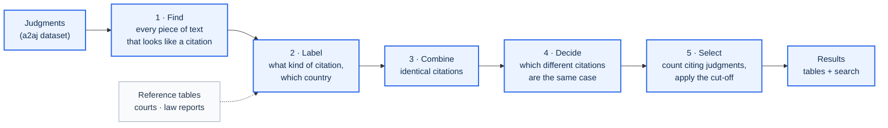

# Case Citation Pipeline

[](https://doi.org/10.5281/zenodo.23149206)

[](LICENSE)

A pipeline that finds case citations in court judgments, works out which differently written citations are the same case, and counts how many different judgments cite each one.

One case is written many ways: the court's own number (`2002 SCC 33`), a law-report reference (`[2002] 2 S.C.R. 235`), a database ID (`2002 CanLII 41642`). Finding a citation is only the start; the references must be linked before anything can be counted. Every counted link leads back to the citing judgment and the passage in its text.

## How it works



1. **Find** anything shaped like a citation. No abbreviation list is needed, so unfamiliar reports are still caught.
2. **Label** each one: what kind of citation, which country, and whether it is only a look-alike (a date, a docket number, a statute).
3. **Combine** identical citations.
4. **Decide** which different citations are the same case, and keep apart different cases that share a name.
5. **Select**: count the different judgments citing each case and apply a cut-off.

Each step keeps its own output and the evidence for its decisions. Nothing is deleted, and where the evidence is missing the answer stays `UNSUPPORTED` or unknown instead of a guess.

## Example

`scripts/demo.py` runs steps 1 and 2 on a made-up paragraph. It needs no data and no internet.

```text
[12] The standard of review was settled in Housen v. Nikolaisen, 2002 SCC 33, [2002] 2 S.C.R. 235.
The English rule in Donoghue v. Stevenson, [1932] A.C. 562 (H.L.), was applied. See also R. v. Oakes,
[1986] 1 S.C.R. 103, and section 7 of the Act, R.S.C. 1985, c. C-46.
```

```console
$ python scripts/demo.py
raw_string            shape                 offset   kind       jurisdiction  parse_status         court
2002 SCC 33           neutral_bare          65       neutral    CA            valid                -
2002 SCC 33           vol_abbr_page         65       reporter   UNSUPPORTED   ambiguous_year_vol   -
[2002] 2 S.C.R. 235   bracket               78       reporter   CA            valid                -
2 S.C.R. 235          vol_abbr_page         85       reporter   CA            valid                -
[1932] A.C. 562       bracket               142      reporter   GB            valid                H.L.
[1986] 1 S.C.R. 103   bracket               201      reporter   CA            valid                -
1 S.C.R. 103          vol_abbr_page         208      reporter   CA            valid                -
```

- `neutral` is the court's own case number; `reporter` is a printed law report.
- Step 1 keeps every possible reading, so `2002 SCC 33` appears twice: correctly as a neutral citation, and misread as volume 2002 of a report called `SCC`, which step 2 marks doubtful. Later steps choose between overlapping readings.
- `[2002] 2 S.C.R. 235` and `2 S.C.R. 235` are one reference matched twice and counted once.
- `(H.L.)` is recorded as the court that decided the English case. The statute reference is not picked up.

## Quick start

Python 3.11 or later; the download script needs `bash` (Git Bash or WSL on Windows).

```bash
git clone https://github.com/yubow47-bot/case-citation-pipeline.git
cd case-citation-pipeline
pip install pyarrow pyyaml

bash scripts/download_corpus.sh download      # judgments from the a2aj dataset into corpus/
python pipeline/run_all.py --out data/run_example --court SCC --court ONCA --court BCCA
python tools/check_run.py --run data/run_example
```

Add `--limit-batches 1` for a small trial run. Allow several gigabytes of disk. The results:

| File | One row per | Contains |
| --- | --- | --- |
| `select_out/selected.csv` | citation spelling | its case group, case name and count of citing judgments |
| `edges/citation_edges.csv` | (citing judgment, cited case) pair | the number of mentions and the evidence for the link |

A new court needs its citation styles and source coverage reviewed first; see the [new-court playbook](docs/method_cards/00_new_court_playbook.md).

## Optional: model-assisted judgments

Some per-case calls are hard to write as rules, such as where a case name begins. These can go to [TypeSafe Jev](https://typesafe.ai) with `--jev live` (set `TYPESAFE_API_KEY`). It is off by default; rule results are always kept, model-judged values are marked, and answers are cached so a run can be replayed with `--jev cache-only`. See [model judgments](docs/method_cards/09_model_judgments.md).

## Repository layout

| Location | Purpose |
| --- | --- |
| `pipeline/` | The five steps and their tests |
| `decisions/` | Sourced reference tables: courts, law reports, identity rules |
| `tools/`, `scripts/` | Run checks and comparisons; the demo and corpus download |
| `docs/` | [Method cards](docs/method_cards/README.md) (one per step), [specification](docs/technical_specification.md), [usage guide](docs/USAGE.md) |
| `corpus/`, `data/` | Downloaded judgments and generated runs (not in Git) |

Known problems and their status are tracked in [PROBLEMS.md](PROBLEMS.md).

## License

MIT, see [LICENSE](LICENSE).
