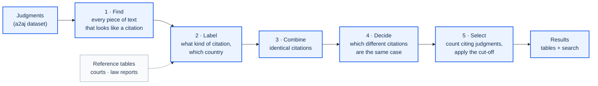

# Case Citation Pipeline

[](https://doi.org/10.5281/zenodo.23149206)

[](LICENSE)
[](https://huggingface.co/datasets/a2aj/canadian-case-law)

Version **v1.1.0**. See [what changed](CHANGELOG.md). The earlier `v1.0.0` tag remains available.

Courts cite earlier cases in many different ways. This project finds those citations, groups references to the same case, and counts how many different judgments cite it. Each counted link can be checked against a passage in the source judgment.

The current dataset covers the Supreme Court of Canada (SCC), the Court of Appeal for Ontario (ONCA), and the Court of Appeal for British Columbia (BCCA). The judgment text comes from the public [a2aj Canadian case law dataset](https://huggingface.co/datasets/a2aj/canadian-case-law).

| Question | Answer |
| --- | --- |
| What problem does it solve? | One case can have a court citation, several law-report references, and different names. These need to be linked before counting. |
| What does it produce? | Citation tables, case groups, counts, source passages, and local search tools. |
| How accurate is it? | A [2026-10-15 model review of 270 links](audit/findings/quality_model_review_20261015/README.md) found **93.9% case mentions** and **90.9% valid case-and-identity links**, weighted among records the model could decide. Those decisions cover **95.3%** and **77.1%** of sample weight, respectively; these are not full-pipeline accuracy scores. The separate historical [T6 CanLII audit](audit/findings/canlii_crosscheck/run_20261002_tables2/t6_calibration.md), for **run_20261002_tables2 (2026-10-02)**, estimated **87.0% real case-citation links overall**, **98.9% at DD 5–9**, and **100% at DD 10+**. |

A citation means that a judgment mentions a case. It does not by itself mean that the court approved, followed, or relied on that case. This is research data, not legal advice. Read [the counting and usage guide](docs/USAGE.md) before quoting a result.

## Current data

The documented snapshot is **run_20261015_identity_review**, completed on **2026-10-15**. It uses English text when available and French text otherwise.

| Measure | Count |
| --- | ---: |
| Source judgment records with text | 49,674 |
| Possible citation matches | 1,472,144 |
| Case groups | 230,449 |
| Links from a source judgment to a case group | 490,577 |
| Counted mentions in those links | 705,476 |
| Case groups cited by at least five different judgments | 14,003 |

The counts come from the retained [release summary](audit/findings/project_review_20261015/release_summary_final.json). The [mention reconciliation](audit/findings/project_review_20261015/edge_counters.json) explains why an older step log shows 716,593 mentions: that number includes 11,117 mentions later excluded as self-citations. Source records, case groups, links, and mentions are different units.

On a configured local installation, `data/active_run.json` selects the run and database. Run `python tools/status.py` to check what is available. Save the run ID with every research result: group IDs and counts can change between runs. Large corpus files and generated databases are local build inputs and outputs; a source checkout alone is not a ready research database.

## What the final data looks like

**DD** means **distinct decisions**: the number of different source judgments that cite a case group. If one judgment mentions the same case twenty times, it adds one to DD and twenty to the mention count.

The main view uses **DD ≥ 5**. Groups below this cut-off remain in the tables and are flagged, so researchers can still inspect them. Five is a working cut-off, not a formally calibrated rule. A group represents the pipeline's decision about case identity; it is not a guarantee that all its references belong together.

## Pipeline



1. **Find** text shaped like a citation, including unfamiliar law reports.
2. **Label** each match by citation type and the available country or court evidence.
3. **Combine** identical citations and choose between overlapping readings.
4. **Decide** which different references belong to the same case.
5. **Select** the main results using DD, while keeping lower-DD groups available.

The [reference tables](decisions/) record evidence used by the rules. An unknown case origin stays unknown. The country of a law report is not always the country where the case began.

Try the first two steps without downloading data or using the internet:

```bash
python scripts/demo.py
```

The demo uses a made-up paragraph containing references such as `2002 SCC 33` and `[2002] 2 S.C.R. 235`. It shows the matched text, its position, citation type, and parsing status. Later steps resolve duplicate readings and join references to the same case.

## Search and research tools


The diagram shows both the implemented tools and the intended search workflow. **Keyword search and exact table queries are ready for the documented run. Vector search is unavailable for that run. AI-written research answers are planned.** Optional vector support in the code does not mean a usable vector index has been built.

Data search returns matching case profiles and source passages. Exact research counts come from the full tables, not from the first few search results. Method search helps maintainers find code, rules, and earlier audit findings. See the [search setup guide](tools/foundation/README.md).

With the current local database ready:

```powershell
python tools/status.py
python tools/foundation/query.py "Donoghue" --mode keyword -k 5
python tools/research/research.py find "Housen" --top 5 --output audit/findings/research/housen.json
python tools/research/research.py ask --intent court_decade --output audit/findings/research/trend.json
python tools/research/research.py ask --intent ranking --top 10 --with-text --output audit/findings/research/top10.json
```

The [research tool](tools/research/README.md) saves the query, parameters, counts, and a limited set of source passages. It supports a small set of question types; it does not answer arbitrary legal questions. The [quality tool](tools/quality/README.md) helps sample and review links. The [citation-context experiment](tools/citation_context/README.md) examines short citations and possible treatment words without changing production counts.

## How well it works

### Current source-text model review

On 2026-10-15, a model assessed all **270 links** in a fixed sample from `run_20261015_identity_review`. It read source evidence and checked both whether a case was mentioned and whether the link pointed to the right judgment.

| Question | Model decisions | Weighted score among decided records | Share of sample weight decided |
| --- | --- | ---: | ---: |
| Does the source mention a case? | 265 yes, 3 no, 2 unknown | 93.9% | 95.3% |
| Is it a case mention linked to the right judgment? | 118 correct, 18 incorrect, 134 unknown | 90.9% | 77.1% |

Weights account for different chances of selection. Unknowns count as neither correct nor incorrect, so the scores describe only the records the model could decide. In particular, **90.9% is not an accuracy estimate for the whole pipeline**. All 270 records received model assessments; none received manual labels in this review. The recorded model was `gpt-6.1-sol`, with 77 assessments at Max and 193 at Medium reasoning effort. See the [review results, raw rates, and reproducible commands](audit/findings/quality_model_review_20261015/README.md).

### Historical CanLII comparison

These are **historical results for run_20261002_tables2**, the run dated **2026-10-02**. The current model review uses a different method and evidence; the two sets of scores are not directly comparable.

The [T6 audit](audit/findings/canlii_crosscheck/run_20261002_tables2/t6_calibration.md) checked **215 links** by reading source text. The links were sampled within a comparison set of **360 judgments** across three courts and three time periods per court. Results were weighted by the number of links in each sampling category; they are not simple percentages of the sample.

| DD of the cited group | Links checked | Weighted share that were real case citations |
| --- | ---: | ---: |
| 1 | 76 | 75.0% |
| 2–4 | 53 | 81.7% |
| 5–9 | 29 | 98.9% |
| 10 or more | 57 | 100% |
| Overall | 215 | 87.0% |

The overall approximate interval was **75.0%–92.3%**. The remaining weighted shares were 8.2% errors and 4.8% mentions of earlier stages or reports of the same case. The audit counted a real case citation as correct even if its group had the wrong name. It therefore does not establish case-identity accuracy or tell us how a court treated a case. Small samples also limit what the 100% result can tell us about other links.

The separate [T2 comparison](audit/findings/canlii_crosscheck/run_20261002_tables2/t2_summary.md) measured how many citations listed by CanLII the pipeline matched. For 40 SCC judgments from 2000–2026, it matched 97.3%; for 40 SCC judgments from 1875–1949, it matched 36.4%. Differences between source texts and CanLII records can affect this comparison, so these are coverage figures against CanLII, not a complete measure of missed text citations.

The original outputs for `run_20261002_tables2`, `run_20261003_selfcite`, and `run_20261003_v16f` have been retired. Small receipts, manifests, logs, and audit reports remain: [retirement receipt and retained record paths](audit/findings/repository_cleanup_20261015/retired_runs.json). These records describe past runs; they cannot replace the original full outputs.

Current output-consistency checks and keyword-search checks do not establish semantic accuracy. Open problems and remaining work are tracked in [PROBLEMS.md](PROBLEMS.md) and [DEBT_LEDGER.md](DEBT_LEDGER.md).

## Quick start

Use Python 3.11 or later. The download script also needs `bash` (Git Bash or WSL on Windows). Allow several gigabytes for the corpus and generated files; storage needs depend on the courts and runs you keep.

```bash
pip install pyarrow pyyaml
bash scripts/download_corpus.sh list
bash scripts/download_corpus.sh download
python scripts/demo.py
python pipeline/run_all.py --out data/run_smoke --limit-batches 1
python pipeline/run_all.py --out data/run_YYYYMMDD_name
```

The default courts are SCC, ONCA, and BCCA. To select others, set `PIPELINE_COURTS` for both the download and pipeline commands. Support for a new court still needs review of its citation styles and source data.

Check a completed run before using its counts:

```bash
python tools/check_run.py --run data/run_YYYYMMDD_name --output audit/findings/run_check.json
```

This reads CSV or compressed CSV files and checks links, group membership, DD, and exclusions. A passing check means the output tables agree with each other; separate audits are needed to measure extraction and identity accuracy.

To build the local keyword-search database, first install the dependencies in the [search setup guide](tools/foundation/README.md), then run:

```bash
python tools/foundation/after_run.py --run data/run_YYYYMMDD_name
```

The default build is offline and skips vectors. New pipeline runs use compressed output and storage limits by default. [Storage tools](tools/storage.py) can inventory files, compress retained runs, and retire selected runs with receipts.

After changing pipeline code, run the relevant checks:

```bash
python pipeline/tests/run_regression.py --selftest
python pipeline/tests/test_layers.py
python pipeline/tests/test_layers.py --golden
```

The last command needs a completed pipeline run for comparison. The full step order is in the [technical specification](docs/technical_specification.md).

## Next steps

- Repeat the citation audit on the current run.
- Improve coverage of unresolved case identities and calibrate the DD cut-off.
- Review unresolved citation styles and expand court coverage.
- Evaluate optional vector search and answers with source references.

## License

The code uses the [MIT License](LICENSE). The judgments come from the [a2aj Canadian case law dataset](https://huggingface.co/datasets/a2aj/canadian-case-law) and have their own terms.
